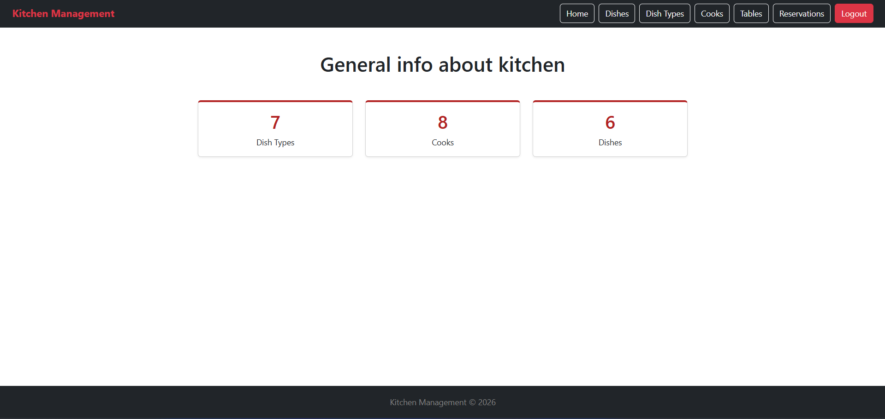

# Kitchen-management

Kitchen Management is a Django web application designed to help restaurant
staff manage cooks, dishes, dish types, tables, and customer reservations.
The system provides authentication and role-based access, allowing staff to manage kitchen data and customers to create
and manage their own table reservations with selected dishes.

## Check it out!

[Kitchen management project deployed to Render](https://kitchen-management-tjs2.onrender.com/)

## Getting Started

These instructions will get you a copy of the project up and running on your local machine for development and testing purposes. See deployment for notes on how to deploy the project on a live system.

### Prerequisites
***
What things you need to install the software

```
Python 3.11 or higher
Git
```

### Installing
***
```shell
git clone https://github.com/gyxx1dd/kitchen-management.git
cd kitchen-management
python -m venv venv
.venv\Scripts\activate
pip install -r requirements.txt
Apply database migrations:
python manage.py migrate
Create a superuser to access the admin panel:
python manage.py createsuperuser
python manage.py runserver #starts Django Server
```

### Built With

***

* Django - Web framework

* SQLite - Database

* Bootstrap - Front-end framework

* django-crispy-forms - Form rendering

## Demo




